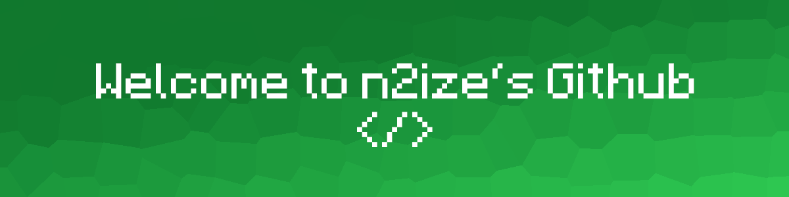

<!-- Hauptfarbe: 168A36 · generiert mit build_readme.py (oder per Suchen & Ersetzen ändern) -->

<!-- ═══════════ BANNER (Platzhalter – in build_readme.py bei BANNER_URL ersetzen) ═══════════ -->

  

<h3></h3>

- 🎓 Student based in **Switzerland**
- 🧠 Currently preparing for my finals
- 🛠️ I love building things
- 🌱 Always learning and exploring new stuff
- ⚒️ Currently working on my Videogame!

<h3></h3>

  
  
  
  
  
  

<h3></h3>

<table>
  <tr>
    <td width="50%" valign="top">
      <h4>😺 <a href="https://github.com/n2ize/Catagochi"><b>Catagochi</b></a></h4>
      
virtual cat tamagochi

      
    </td>
    <td width="50%" valign="top">
      <h4>🐸 <a href="https://github.com/n2ize/FroschRoguelike"><b>Frog with a gun</b></a></h4>
      
a game built with Godot in development.

      
      
    </td>
  </tr>
</table>

<h3></h3>

  
  
  

<!--*“”*-->

